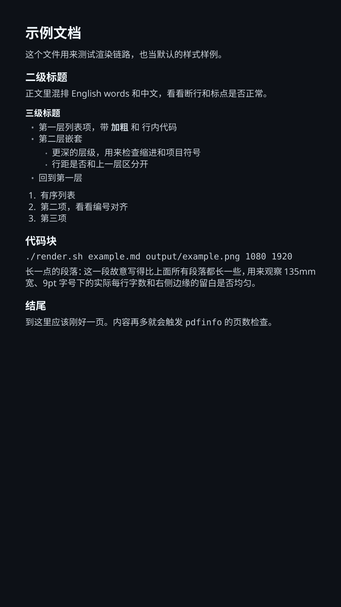

# Markdown → 竖屏 PNG 壁纸

用 Pandoc + XeLaTeX + `pdftocairo` 把一份 Markdown 笔记渲染成 1080×1920 的
PNG，直接当手机壁纸用。不依赖浏览器、Node 或任何壁纸软件。



## 为什么走 TeX 而不是 HTML/CSS

同类项目基本都把 Markdown 转成 HTML 再用浏览器截图（imgkit / wkhtmltopdf /
Playwright）。这条路装起来简单，但两件事做不好：

1. **中文断行。** 中英混排的笔记里，浏览器给的寡妇行和标点位置经常没法看，
   XeLaTeX 的处理明显更稳。
2. **单页约束。** 壁纸的前提是一屏装得下，而浏览器方案通常靠自动分页或滚动
   截图绕开这个真正的难题。

代价是要装 TeX Live（1GB 以上）并指定字体。如果你不写中文笔记，或者不介意
分页，用浏览器方案更省事。

## 依赖

| 用途 | 包 |
| --- | --- |
| 转换 | `pandoc` |
| 排版 | `texlive-xetex`、`texlive-latex-extra`（xcolor / titlesec / enumitem） |
| 取页数、转 PNG | `poppler-utils`（`pdfinfo`、`pdftocairo`） |
| 字体 | `fonts-noto-cjk`、`fonts-dejavu` |

Debian / Ubuntu / WSL：

```bash
sudo apt install pandoc texlive-xetex texlive-latex-extra poppler-utils \
  fonts-noto-cjk fonts-dejavu
```

`render.sh` 里写死的主字体是 `Noto Sans`，中文是 `Noto Sans CJK SC`，等宽是
`DejaVu Sans Mono`。换机器如果字体名对不上，改 `render.sh` 里的
`--variable` 即可。

## 用法

```bash
./render.sh                                   # todo.md → output/todo.png，1080×1920
./render.sh notes.md output/notes.png 1440 2560
```

参数依次是：输入 Markdown、输出 PNG、宽、高。宽高限制在 320–7680，输出必须
以 `.png` 结尾。目录不存在会自动创建。

## 排版参数

纸张 135mm × 240mm，渲染到 1080×1920 时约 203 DPI；页边距 10mm / 12mm /
10mm / 10mm，正文 9pt，行距 1.08。标题层级、列表间距、配色都在 `theme.tex`
里，改样式不用动 shell 脚本。

## 单页是硬约束

`render.sh` 渲染完会用 `pdfinfo` 数页数，只要不是 1 页就直接报错退出，不会给
你一张被截断的图：

```
Markdown rendered to 2 pages; a fixed wallpaper PNG must fit on one page.
Shorten the document or reduce the font size in render.sh.
```

这是整个脚本最要紧的一个设计取舍：壁纸装不下的唯一解法是删内容或降字号，
不是分页。

## 不适合的场景

- 内容超过一页（表格多、代码块多、列表长）
- 需要频繁调样式（每改一次都要动 LaTeX）
- 目标机器上没有 TeX 环境

## 相关项目

这些项目解决同样的问题，走 HTML/CSS 路线，上手比这个快：

| 项目 | 技术栈 |
| --- | --- |
| [ryanraposo/allpaper](https://github.com/ryanraposo/allpaper) | Python + imgkit + markdown2，四宫格拼贴 |
| [kyaoNK/markdown-wallpaperimage](https://github.com/kyaoNK/markdown-wallpaperimage) | VS Code 扩展，CSS 定制 |
| [CristianoFIlho/CLI-Wallpaper-Generator](https://github.com/CristianoFIlho/CLI-Wallpaper-Generator) | Node + Playwright |
| [Jeetski/walltext](https://github.com/Jeetski/walltext) | Windows CLI，文本/Markdown → 桌面壁纸 |
| [ddabb/mdconvert](https://github.com/ddabb/mdconvert) | HTML/PNG，40+ 模板，中文社媒风 |
